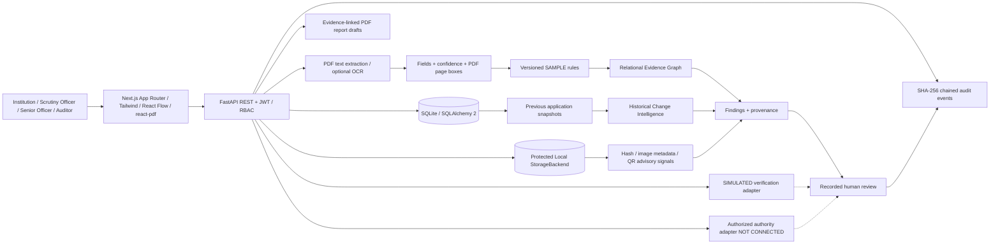

# ProofGraph architecture (Mermaid)

## Core source files

- `backend/app/models.py` – all minimum relational entities.
- `backend/app/processing.py` – PDF text extraction, Tesseract OCR fallback, normalized fields, region boxes, advisory checks.
- `backend/app/engine.py` – versioned sample validation, contradictions, historical diffs, relational evidence graph, duplicates, match alerts, queue priority.
- `backend/app/verification.py` – simulated and unconfigured authority adapters.
- `backend/app/audit.py` – deterministic content hashing and integrity replay.
- `backend/app/reports.py` – PDF report and deficiency notice drafts.
- `backend/app/security.py` – PBKDF2 password hashes, JWT, role checks, optional Fernet.
- `backend/app/llm.py` – no-key local explainer and provider extension point.
- `backend/seed.py` – three hero cases and 30 labeled synthetic evaluation cases with source PDFs.
- `frontend/components/evidence-graph.tsx` – graph exploration with source-node selection.
- `frontend/components/document-viewer.tsx` – token-protected PDF viewer and bounding-box overlays.
- `frontend/app/cases/[id]/page.tsx` – workbench, findings and workflows.

## Intentional offline deployment boundaries

Backend and frontend are local development processes, with SQLite and a local document store. No Redis, Docker, broker, government endpoint, cloud OCR, or paid LLM is required. A `StorageBackend` interface and database-agnostic SQLAlchemy models allow later system substitutions. Scaling and hardening are deferred and explicitly listed in `LIMITATIONS.md`.
