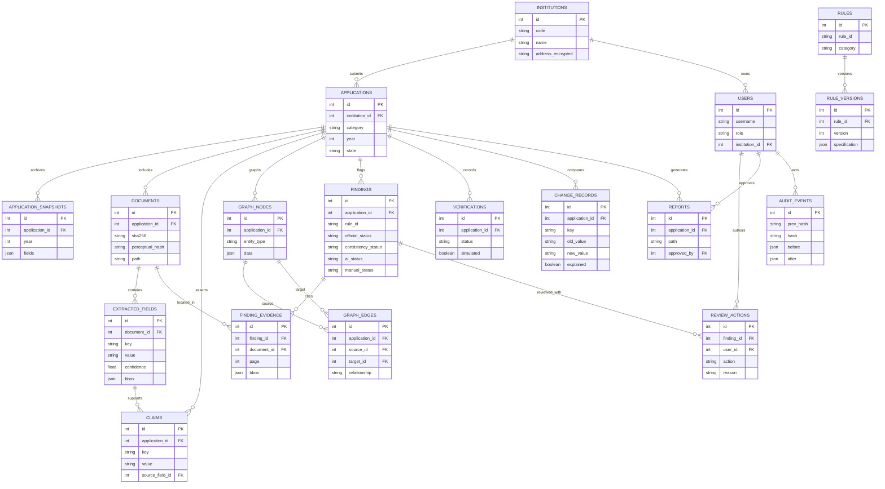

# Minimum relational entity model

The evidence graph is relational, not a remote graph service: `graph_nodes` and `graph_edges` use the same SQLite file. The `neighborhood` helper in `backend/app/engine.py` demonstrates graph traversal with a SQLite recursive CTE.
